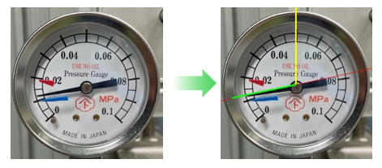

# Bourdon Tube Pressure Gauge Analyzer (ブルドン管圧力計 画像解析ツール)

このリポジトリは、ブルドン管圧力計（または連成計）の画像を自動解析し、OCRによるスケール範囲（最小値・最大値）の抽出と、幾何学的アプローチ（ハフ変換を用いた針の検出とセンター補正）による圧力値の算出を行うPythonプログラムです。

## 💡 技術的特徴・設計のこだわり

本プログラムは、単なるライブラリの呼び出しに留まらず、実務の現場で直面するノイズや環境変化に対応するための高度なコンピュータビジョン技術とエンジニアリング上の工夫が組み込まれています。

1. **高度なコンピュータビジョン（OpenCV）の幾何学演算**
   * `cv2.HoughCircles` や `cv2.HoughLines` を駆使して、アナログメーターの外周円や目盛り・指針の直線を自動検出します。
   * ベクトル計算（`np.hypot`、`np.arctan2`、内積・外積、偏角の算出）を用い、検出されたラインと真上基準線の交点からセンター位置を動的に補正して正確な物理量を逆算します。

2. **OCRの弱点を補う強力な前処理・後処理**
   * **CLAHE（適応的ヒストグラム平坦化）** や画像のリサイズにより、文字の視認性をあらかじめ高めています。
   * **HSV色空間による「赤色マスク」** を独自に実装し、マイナス値を示す赤文字を自動判定・補正することで、OCR単体では困難な誤認識を防ぎます。

3. **堅牢性（ロバスト性）を考慮した二段階フォールバック設計**
   * 標準の全体解析（STEP1）で適切なスケール抽出に失敗した場合、自動的に特定セクターを個別スキャンするフォールバック処理（STEP2）へシームレスに移行する堅牢な設計になっています。

## 🛠 主な機能

1. **出力フォルダの自動初期化**:
   * 実行時に `output` ディレクトリを自動で作成・クリーンアップし、デバッグ画像を保存します。

2. **メーター枠の自動検出**:
   * ハフ円変換を利用して圧力計の外周円および中心座標・半径を動的に特定します。

3. **スケール範囲の自動抽出 (OCR)**:
   * EasyOCR および各種前処理を用いて最小値 (`kmn`) と最大値 (`kmx`) を自動抽出します。

## 📷 Screenshots



## 📦 動作環境・必要ライブラリ

以下のPythonライブラリが必要です。事前にインストールしてください。

* Python 3.8 以上推奨
* OpenCV (`cv2`)
* NumPy
* EasyOCR

### インストールコマンド例

```bash
pip install opencv-python numpy easyocr
```

## 🚀 使い方

1. 解析対象の圧力計画像をスクリプトと同じディレクトリに配置します（デフォルト: `moto meter.jpg`）。
2. スクリプトを実行します。

```bash
python Pressure_Gauge_Analyzer.py
```

3. 処理が完了すると、コンソールに検出されたスケール範囲と最終的な解析圧力が出力されます。また、`output/` フォルダ内にデバッグ用の画像が出力されます。

## 📁 ディレクトリ構造

```text
.
├── Pressure_Gauge_Analyzer.py            # メインの解析プログラム（リファクタリング済み）
├── moto meter.jpg     　　　　　　　　　　 # 解析対象の圧力計画像（サンプル）
└── output/                               # デバッグ画像および処理用一時フォルダ
    ├── out_sample2.jpg
    ├── meter_line.jpg
    └── fallback_*.jpg
```

## 📄 ライセンスと著作権 (License & Copyright)

* **著作権 (Copyright)**: © 2026 Freelancer JOE. All Rights Reserved.
* **ライセンス (License)**: 本ソフトウェアは **Apache License 2.0** のもとで公開されています。

## 📝 注意事項

* EasyOCRの初回実行時、言語モデルのダウンロードにインターネット接続が必要となる場合があります。
* 画像内の圧力計が極端に傾いていたり、照明の反射が強すぎる場合は正しく認識されないことがあります。
